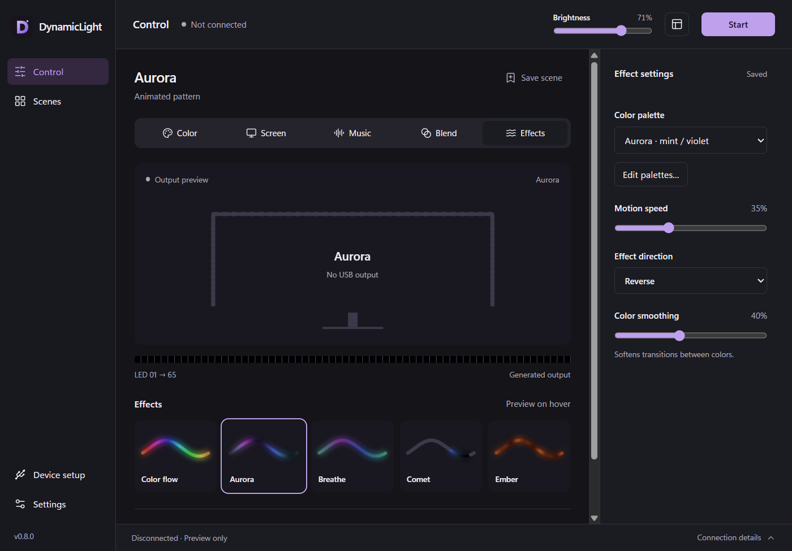

# DynamicLight

A local desktop lighting studio for [compatible ROBOBLOQ USB LED strips](#compatibility-and-privacy). Sync lights with your screen or music, design effects and zones, save scenes, and control your setup from the desktop, terminal, or a paired phone.

**Windows · macOS · Linux** · Free and open source · No account required

[Download](https://github.com/mskutin/DynamicLight/releases/latest) · [Installation guide](docs/installation.md) · [Controls guide](docs/controls.md) · [Report a problem](https://github.com/mskutin/DynamicLight/issues/new/choose)



## Install

Download a desktop package from [GitHub Releases](https://github.com/mskutin/DynamicLight/releases/latest). No development tools or GitHub account are needed; the source-code archives are not installers.

| Your computer | Download |
| --- | --- |
| Windows x64 | [Windows installer](https://github.com/mskutin/DynamicLight/releases/latest/download/dynamiclight-desktop-windows-x64-setup.exe) |
| Mac with Apple silicon | [ARM64 disk image](https://github.com/mskutin/DynamicLight/releases/latest/download/dynamiclight-desktop-macos-arm64.dmg) |
| Mac with Intel | [x64 disk image](https://github.com/mskutin/DynamicLight/releases/latest/download/dynamiclight-desktop-macos-x64.dmg) |
| Linux x64 | [Debian package](https://github.com/mskutin/DynamicLight/releases/latest/download/dynamiclight-desktop-linux-x64.deb) or [AppImage](https://github.com/mskutin/DynamicLight/releases/latest/download/dynamiclight-desktop-linux-x64.AppImage) |

Packages are preview builds without Windows publisher signing or macOS notarization, so the OS may ask you to approve opening them. macOS requires 13 or newer. Linux targets Ubuntu 24.04+ and needs the [Linux dependency and USB setup](docs/linux.md); screen capture requires X11. Windows ARM64/32-bit and Linux ARM64 packages are not available.

### From a terminal

Quit DynamicLight before installing or updating. Download the script, inspect it if desired, then run it as your normal user.

**Windows — PowerShell 5.1 or newer:**

```powershell
Invoke-WebRequest -UseBasicParsing https://github.com/mskutin/DynamicLight/releases/latest/download/install.ps1 -OutFile install.ps1
powershell -NoProfile -ExecutionPolicy Bypass -File .\install.ps1
```

**macOS / Linux — Bash and curl:**

```sh
curl -fsSL https://github.com/mskutin/DynamicLight/releases/latest/download/install.sh -o install.sh
bash install.sh
```

The scripts verify SHA-256 checksums and install the latest release. Windows installs per user; macOS installs into `~/Applications`; Linux uses `sudo apt-get install`. For a user-local Linux AppImage, use `bash install.sh --appimage` and complete the one-time [AppImage setup](docs/linux.md#appimage). Open the app after installation. Rerun the installer to update while preserving settings. See [installation options](docs/installation.md) for version pinning, download-only mode, and uninstalling.

### In-app updates

**Settings → App updates** checks for releases automatically and offers **Install and restart** on Windows, writable macOS app installations, and Linux AppImage. Update packages are cryptographically verified; this is separate from OS publisher signing. Automatic checks can be disabled. Debian packages use the terminal installer or package manager. Versions before 0.9.0 need one manual upgrade to gain the updater.

## First run

1. Plug in a supported strip and close SyncLight or other software controlling it.
2. Choose **Color**, **Screen**, **Music**, **Blend**, or **Effects** to connect and start lighting. Grant OS capture permissions when using screen or audio sources.
3. Open **Device setup → Calibrate strip** to check LED count, edge coverage, direction, and starting offset.
4. Adjust brightness in the header and tune the mode in the inspector. Use **Save scene** to keep a setup and **Stop** to turn the lights off.

Each mode remembers its tuning. Browsing views and previewing effects does not start capture. Closing the window leaves lighting running in the tray/menu bar; use **Quit DynamicLight** in Settings or the tray to exit.

## Lighting modes

| Mode | What you can do |
| --- | --- |
| **Color** | Choose a solid color with the wheel, RGB/hex input, palettes, or approximate white temperature. Tune bias lighting with per-channel gains and saved calibration notes. |
| **Screen** | Sample a full display, a selected window, or a rectangular region. Preview a window and select just its video area to exclude browser toolbars and white margins. Adjust black-bar detection, RGB balance, gamma, and saturation. |
| **Music** | React to computer audio or a microphone with spectrum, bass, level, and wave styles, plus beat response and gain/noise-gate/release tuning. |
| **Blend** | Combine screen colors with audio-reactive brightness; keep the available source running if the other fails. |
| **Effects** | Run Color flow, Aurora, Breathe, Comet, and Ember, or create layered effects with gradients, waves, breathing, and color sequences. |
| **RGB replay** | Play recorded LED colors without live capture, with trim, speed, loop, and explicit remapping for another strip layout. Open it from **Scenes → Record / replay RGB sequence**. |

The preview shows generated LED colors. Connection details reports USB delivery, not a measurement of whether the physical LEDs are lit. See the [controls guide](docs/controls.md) and [capture source guide](docs/capture-sources.md).

## Build and reuse your setup

- **Scenes and palettes:** Save, search, duplicate, reorder, and favorite scenes; assign global shortcuts or start with Warm Desk, Cinema, Neon, and Ocean. Import/export scenes and palettes with a conflict preview. Machine-specific device bindings and capture permissions stay local.
- **Studio authoring:** Combine up to four effect layers, save reusable effects, and assign colors or effects to up to sixteen zones. Select LEDs, ranges, or edges in the layout preview; Apply, Cancel, and Undo keep editing deliberate. [Studio guide](docs/studio-authoring.md).
- **Image palettes and appearance:** Extract editable palettes from local images, or the static Windows wallpaper. Choose light/dark/system themes, accents, and compact or spacious controls. White-temperature previews are RGB approximations, not measured color accuracy.
- **Record and replay:** Capture up to 60 seconds of generated RGB output and export it for offline playback. Recordings contain LED colors, never screenshots or audio. Replay scenes reference a separate sequence file, which must also be transferred to another computer. [Recording guide](docs/rgb-sequences.md).
- **Everyday controls:** Use the tray/menu bar, global scene shortcuts, or a floating Quick controls window with optional always-on-top behavior. Brightness caps, transition limits, and minimum glow help tune comfort. Startup, restore, and automatic capture recovery are opt-in.

## Routines and multiple strips

**Scenes → Schedules, timers & app rules** provides weekday schedules with fades, foreground-application scene switching, focus/break timers, temporary color cues, and quiet hours. Routines run while the desktop app is open and use offline scenes; they do not start screen or audio capture. Missed schedules are skipped on wake. [Routines guide](docs/routines.md).

**Device setup → Controllers & monitor layout** supports up to eight compatible controllers with independent scenes, sources, and settings. Map strips to displays, adjust the layout diagram, and use grouped Start/Stop and brightness while preserving each strip's own brightness setting.

Export a scene and physical calibration for another computer with **USB handoff**; a physical USB switch or unplug/replug is still required. Optional **ambient brightness** follows a supported Windows light sensor, Linux IIO sensor, or external lux input on any platform. macOS currently uses external input. [Controller, handoff, and sensor guide](docs/controller-routing.md).

## Terminal and local API

Enable **Settings → Local automation** and keep the desktop app running. Install the companion CLI using the script downloaded above:

**Windows:**

```powershell
powershell -NoProfile -ExecutionPolicy Bypass -File .\install.ps1 -Cli
$env:PATH = "$env:LOCALAPPDATA\DynamicLightCLI\bin;$env:PATH"
```

**macOS / Linux:**

```sh
bash install.sh --cli
export PATH="$HOME/.local/bin:$PATH"
```

These PATH changes affect the current terminal; the installers do not edit your persistent PATH. Then:

```sh
dynamiclight status --json
dynamiclight color '#336699'
dynamiclight brightness 35
dynamiclight power on
dynamiclight scenes list
dynamiclight scenes apply warm-desk
dynamiclight routines status --json
dynamiclight power off
```

Color and brightness changes preserve the stopped state; applying a scene starts lighting. The CLI controls the running desktop engine through an authenticated, loopback-only API. Capture commands require both the Settings permission and `--allow-capture`. Rerun the CLI installer to update it; desktop updates do not update the CLI. See [CLI/API commands, Stream Deck, and integration examples](docs/automation.md).

## Phone, games, and plugins

**Phone remote:** In **Device setup → Phone remote**, choose a private network interface and controller, enable HTTPS, and pair a phone with the expiring code. Control power, brightness, solid color, and saved offline profiles from the same network. Pairings can be revoked and reset on app restart. The remote uses a session-specific self-signed certificate, so the phone browser must support inspecting and accepting it; follow the [pairing guide](docs/phone-remote.md). Real iOS/Android browser and firewall validation is still pending.

**Counter-Strike 2:** Open **Device setup → Games & plugins**, enable telemetry, and export the Valve Game State Integration configuration. Map damage, kills, round starts, and bomb plants to temporary colored zones. Telemetry is opt-in and uses a local authenticated receiver; re-enabling it requires a fresh game configuration. Live game/hardware validation remains pending.

**Declarative plugins:** Import local effect compositions or game-event-to-cue rules, preview them, then explicitly enable them. Plugins use bounded data-only definitions; they cannot execute JavaScript, WASM, or native code. Plugins start disabled after an app restart. See the [games and plugins guide](docs/extensions.md) and [example manifests](examples/plugins).

## Compatibility and privacy

DynamicLight supports the SyncLight-compatible **ROBOBLOQ USB controller (1A86:FE07)** with **1–127 LEDs per strip**. A USB plug alone does not mean a strip is compatible.

Screen and audio processing stay on your computer. Local automation, phone access, game telemetry, and sensor control are optional. Phone controls cannot start capture or access captured content. Update checks contact GitHub; image palette imports are processed locally. Troubleshooting reports omit screen content, audio, paths, and identifiers, and optional local history can be cleared or disabled.

Platform capabilities differ: Linux screen/window capture and foreground-app rules require X11; Wayland equivalents are unavailable. Protected video may produce black frames, and HDR colors can differ from the display. Windows selected-window capture requires Windows 10 1903 or newer. Physical Mac/Linux hardware, newer multi-strip/sensor features, lifecycle behavior, and screen-reader checks remain in the [validation checklist](docs/backlog-validation.md). Automated builds and tests do not establish hardware parity.

## Documentation and development

- [Troubleshooting](docs/troubleshooting.md) — connection problems, permissions, and diagnostic reports.
- [Linux setup](docs/linux.md) — dependencies, USB permissions, AppImage, and desktop limitations.
- [Developer guide](docs/development.md) — Tauri/Rust architecture, prerequisites, tests, packaging, and release automation.
- [Backlog and validation status](BACKLOG.md) — delivered features and outstanding physical checks.
- [Contributing](CONTRIBUTING.md) — development and issue-reporting guidance.

With the [native build prerequisites](docs/development.md#develop), Rust, Node.js 24, and pnpm 11 installed:

```sh
pnpm install --frozen-lockfile
pnpm start
```

[GitHub Releases](https://github.com/mskutin/DynamicLight/releases/latest) contains installable packages and production updates. [Actions](https://github.com/mskutin/DynamicLight/actions/workflows/build.yml) also provides development artifacts; PR and branch builds use test updater keys and cannot accept production updates.

Released under the [MIT License](LICENSE). Copyright © 2026 mskutin.
