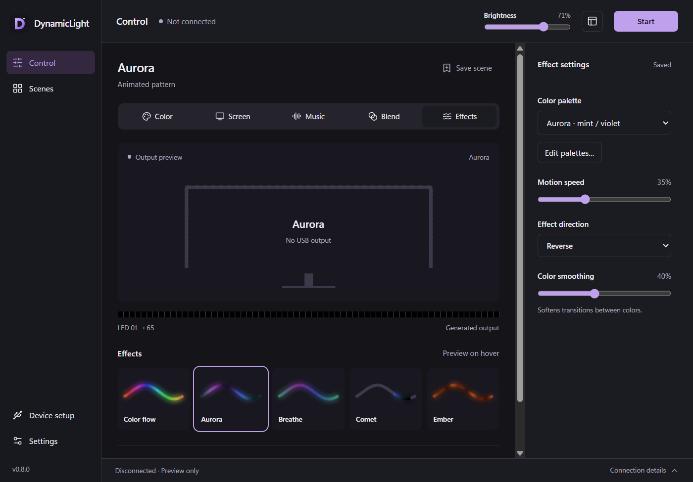

# DynamicLight

Локальная студия подсветки для [совместимых USB-светодиодных лент ROBOBLOQ](#совместимость-и-приватность). Синхронизируйте свет с экраном или музыкой, создавайте эффекты и зоны, сохраняйте сцены и управляйте лентой с компьютера, из терминала или с привязанного телефона.

**Windows · macOS · Linux** · Бесплатно, с открытым исходным кодом · Аккаунт не нужен

[English](README.md) · **Русский** — форк [mskutin/DynamicLight](https://github.com/mskutin/DynamicLight), см. [О форке](#о-форке).

[Скачать](https://github.com/BrenOne/DynamicLight/releases/latest) · [Установка](docs/installation.md) · [Управление](docs/controls.md) · [Сообщить о проблеме](https://github.com/BrenOne/DynamicLight/issues/new/choose)



## О форке

Это форк [mskutin/DynamicLight](https://github.com/mskutin/DynamicLight), который ведёт [BrenOne](https://github.com/BrenOne): со своими релизами и обновлениями прямо из приложения. Что он добавляет:

- **Стабильный вывод на Robobloq:** ровные USB-кадры, автоопределение раскладки ленты и до 60 кадров/с ([предложено в upstream](https://github.com/mskutin/DynamicLight/pull/68)).
- **Caps/Num/Scroll Lock (Windows):** Windows обновляет индикаторы клавиатуры через сам контроллер, из-за чего лента вспыхивала выше 30 кадров/с. Теперь приложение от этого защищено. Нужны права администратора; без них вывод ограничен 30 кадрами/с, это всегда стабильно.
- **Запуск с правами администратора без команд оболочки (Windows):** повышенный запуск и **автозапуск при входе** используют задачи Планировщика, которые создаются через API Windows после одного подтверждения UAC, отдельно для каждого пользователя Windows. Никаких командных строк `cmd.exe`/`schtasks`: именно их антивирусная эвристика принимает за вредоносное закрепление в системе. При входе приложение ждёт появления панели задач, поэтому значок в трее появляется всегда.
- **Несколько пользователей Windows и удалённый рабочий стол:** лента принадлежит сеансу за физическим экраном. Пока активен другой пользователь или сеанс удалённого рабочего стола, приложение отпускает ленту и снова берёт её, когда вы возвращаетесь.
- **Выключение:** лента гаснет при выключении, перезагрузке и выходе из системы Windows.
- **Сборки для всех систем:** пакеты для Windows, macOS и Linux собираются и публикуются автоматически. Если сборка для macOS или Linux не удалась, релиз выходит без неё и сообщает об этом; эти две платформы экспериментальные, их не проверяли на реальном контроллере.

Ошибки, найденные в этом форке, отправляйте в [его задачи](https://github.com/BrenOne/DynamicLight/issues/new/choose). Руководства в `docs/` на английском.

## Установка

Скачайте пакет для рабочего стола со страницы [GitHub Releases](https://github.com/BrenOne/DynamicLight/releases/latest). Инструменты разработки и аккаунт GitHub не нужны; архивы с исходным кодом установщиками не являются.

| Ваш компьютер | Что скачать |
| --- | --- |
| Windows x64 | [Установщик для Windows](https://github.com/BrenOne/DynamicLight/releases/latest/download/dynamiclight-desktop-windows-x64-setup.exe) |
| Mac с Apple silicon | [Образ диска ARM64](https://github.com/BrenOne/DynamicLight/releases/latest/download/dynamiclight-desktop-macos-arm64.dmg) |
| Mac с Intel | [Образ диска x64](https://github.com/BrenOne/DynamicLight/releases/latest/download/dynamiclight-desktop-macos-x64.dmg) |
| Linux x64 | [Пакет Debian](https://github.com/BrenOne/DynamicLight/releases/latest/download/dynamiclight-desktop-linux-x64.deb) или [AppImage](https://github.com/BrenOne/DynamicLight/releases/latest/download/dynamiclight-desktop-linux-x64.AppImage) |

Пакеты — предварительные сборки без подписи издателя Windows и без нотаризации macOS, поэтому система может попросить подтвердить запуск (Windows SmartScreen: **Подробнее → Выполнить в любом случае**). В Windows приложение один раз просит подтверждение администратора, когда вы включаете **автозапуск при входе** или перезапускаете его с повышенными правами. macOS нужна версия 13 или новее. Linux рассчитан на Ubuntu 24.04+ и требует [установки зависимостей и настройки USB](docs/linux.md); захват экрана работает только в X11. Пакетов для Windows ARM64/32-бит и Linux ARM64 нет.

### Из терминала

Закройте DynamicLight перед установкой или обновлением. Скачайте скрипт, при желании просмотрите его и запустите от обычного пользователя.

**Windows — PowerShell 5.1 или новее:**

```powershell
Invoke-WebRequest -UseBasicParsing https://github.com/BrenOne/DynamicLight/releases/latest/download/install.ps1 -OutFile install.ps1
powershell -NoProfile -ExecutionPolicy Bypass -File .\install.ps1
```

**macOS / Linux — Bash и curl:**

```sh
curl -fsSL https://github.com/BrenOne/DynamicLight/releases/latest/download/install.sh -o install.sh
bash install.sh
```

Скрипты проверяют контрольные суммы SHA-256 и ставят последний релиз. В Windows установка идёт для текущего пользователя, в macOS — в `~/Applications`, в Linux используется `sudo apt-get install`. Для AppImage в домашнем каталоге Linux выполните `bash install.sh --appimage` и один раз сделайте [настройку AppImage](docs/linux.md#appimage). После установки откройте приложение. Чтобы обновиться с сохранением настроек, запустите установщик ещё раз. Закрепление версии, режим «только скачать» и удаление описаны в [параметрах установки](docs/installation.md).

### Обновления из приложения

**Настройки → Обновления приложения** проверяют релизы автоматически и предлагают **Установить и перезапустить** в Windows, в macOS при доступной для записи установке и в Linux AppImage. Пакеты обновлений проверяются криптографически; это не то же самое, что подпись издателя ОС. Автоматическую проверку можно отключить. Пакеты Debian обновляются установщиком из терминала или менеджером пакетов. Версиям до 0.9.0 нужно один раз обновиться вручную, чтобы получить обновление из приложения.

## Первый запуск

1. Подключите поддерживаемую ленту и закройте SyncLight и другое ПО, которое ею управляет.
2. Выберите **Цвет**, **Экран**, **Музыка**, **Смесь** или **Эффекты**, чтобы подключиться и запустить подсветку. При использовании экрана или звука разрешите ОС захват.
3. Откройте **Настройка устройства → Калибровка ленты**, чтобы проверить число светодиодов, охват краёв, направление и начальное смещение.
4. Яркость настраивается в шапке, режим — в инспекторе. **Сохранить сцену** запоминает настройки, **Стоп** выключает свет.

Каждый режим помнит свои настройки. Просмотр экранов и предпросмотр эффектов захват не запускает. Закрытие окна оставляет подсветку работать в трее или строке меню; чтобы выйти, используйте **Выйти из DynamicLight** в настройках или в трее.

## Режимы подсветки

| Режим | Что можно делать |
| --- | --- |
| **Цвет** | Выбрать сплошной цвет кругом, вводом RGB/hex, палитрами или приблизительной цветовой температурой белого. Настроить фоновую подсветку усилением по каналам и сохранёнными заметками о калибровке. |
| **Экран** | Брать цвета со всего дисплея, выбранного окна или прямоугольной области. Предпросмотр окна и выбор только области видео убирают панели браузера и белые поля. Настраиваются определение чёрных полос, баланс RGB, гамма и насыщенность. |
| **Музыка** | Реагировать на звук компьютера или микрофон стилями спектра, баса, уровня и волны, а также откликом на ритм и настройкой усиления, шумоподавления и затухания. |
| **Смесь** | Совместить цвета экрана с яркостью, зависящей от звука; если один источник пропал, другой продолжает работать. |
| **Эффекты** | Запускать «Цветной поток», «Северное сияние», «Дыхание», «Комета» и «Угли» или собирать слоистые эффекты из градиентов, волн, дыхания и последовательностей цветов. |
| **Повтор RGB** | Воспроизводить записанные цвета светодиодов без живого захвата: с обрезкой, скоростью, зацикливанием и явным переносом на другую раскладку ленты. Открывается через **Сцены → Запись / повтор RGB-последовательности**. |

Предпросмотр показывает сгенерированные цвета светодиодов. «Сведения о подключении» отражают доставку по USB, а не измерение того, горят ли светодиоды физически. См. [руководство по управлению](docs/controls.md) и [руководство по источникам захвата](docs/capture-sources.md).

## Свои настройки и их повторное использование

- **Сцены и палитры:** сохраняйте, ищите, дублируйте, упорядочивайте и отмечайте избранные сцены; назначайте глобальные сочетания клавиш или начинайте со «Тёплого стола», «Кино», «Неона» и «Океана». Сцены и палитры можно импортировать и экспортировать с предпросмотром конфликтов. Привязки к устройству и разрешения на захват остаются на этом компьютере.
- **Студия:** комбинируйте до четырёх слоёв эффектов, сохраняйте готовые эффекты и назначайте цвета и эффекты до шестнадцати зон. Выбирайте светодиоды, диапазоны или края в предпросмотре раскладки; «Применить», «Отмена» и «Назад» делают правку осознанной. [Руководство по студии](docs/studio-authoring.md).
- **Палитры из картинок и оформление:** извлекайте редактируемые палитры из локальных изображений или статических обоев Windows. Светлая, тёмная или системная тема, акценты, компактные или просторные элементы. Предпросмотр цветовой температуры белого — приближение RGB, а не измеренная точность цвета.
- **Запись и повтор:** записывайте до 60 секунд сгенерированного RGB-вывода и экспортируйте для воспроизведения без захвата. В записях только цвета светодиодов, никогда скриншоты или звук. Сцены повтора ссылаются на отдельный файл последовательности, который тоже нужно перенести на другой компьютер. [Руководство по записи](docs/rgb-sequences.md).
- **Повседневное управление:** трей или строка меню, глобальные сочетания сцен или плавающее окно «Быстрое управление» с необязательным режимом «поверх всех окон». Ограничения яркости и переходов и минимальное свечение помогают подобрать комфорт. Автозапуск, восстановление и автоматическое возобновление захвата включаются по желанию.

## Расписания и несколько лент

**Сцены → Расписания, таймеры и правила приложений** дают недельные расписания с плавными переходами, смену сцены по активному приложению, таймеры фокуса и перерыва, временные цветовые сигналы и тихие часы. Расписания работают, пока открыто приложение, и используют сцены без захвата; захват экрана или звука они не запускают. Пропущенные расписания после пробуждения пропускаются. [Руководство по расписаниям](docs/routines.md).

**Настройка устройства → Контроллеры и раскладка мониторов** поддерживает до восьми совместимых контроллеров с независимыми сценами, источниками и настройками. Сопоставляйте ленты с дисплеями, меняйте схему раскладки, пользуйтесь общим запуском/остановкой и общей яркостью, сохраняя собственную яркость каждой ленты.

**USB-передача** переносит сцену и физическую калибровку на другой компьютер; физическое переключение USB или повторное подключение по-прежнему нужно. Необязательная **яркость по освещённости** следует за поддерживаемым датчиком света Windows, датчиком Linux IIO или внешним значением люкс на любой платформе. В macOS пока доступен только внешний ввод. [Руководство по контроллерам, передаче и датчикам](docs/controller-routing.md).

## Терминал и локальный API

Включите **Настройки → Локальная автоматизация** и держите приложение запущенным. Установите консольную утилиту скриптом, скачанным выше:

**Windows:**

```powershell
powershell -NoProfile -ExecutionPolicy Bypass -File .\install.ps1 -Cli
$env:PATH = "$env:LOCALAPPDATA\DynamicLightCLI\bin;$env:PATH"
```

**macOS / Linux:**

```sh
bash install.sh --cli
export PATH="$HOME/.local/bin:$PATH"
```

Эти изменения PATH действуют только в текущем терминале; установщики постоянный PATH не меняют. Дальше:

```sh
dynamiclight status --json
dynamiclight color '#336699'
dynamiclight brightness 35
dynamiclight power on
dynamiclight scenes list
dynamiclight scenes apply warm-desk
dynamiclight routines status --json
dynamiclight power off
```

Смена цвета и яркости сохраняет остановленное состояние; применение сцены запускает подсветку. Утилита управляет работающим движком приложения через аутентифицированный API, доступный только на loopback. Команды захвата требуют и разрешения в настройках, и флага `--allow-capture`. Чтобы обновить утилиту, запустите её установщик ещё раз: обновления приложения её не обновляют. См. [команды CLI/API, Stream Deck и примеры интеграций](docs/automation.md).

## Телефон, игры и плагины

**Пульт на телефоне:** в **Настройка устройства → Пульт на телефоне** выберите частный сетевой интерфейс и контроллер, включите HTTPS и свяжите телефон по одноразовому коду. Из той же сети можно управлять питанием, яркостью, сплошным цветом и сохранёнными профилями без захвата. Связи можно отозвать, они сбрасываются при перезапуске приложения. Пульт использует самоподписанный сертификат для каждого сеанса, поэтому браузер телефона должен позволять проверить и принять его; см. [руководство по связыванию](docs/phone-remote.md). Проверка на реальных браузерах iOS/Android и брандмауэрах ещё не выполнена.

**Counter-Strike 2:** откройте **Настройка устройства → Игры и плагины**, включите телеметрию и экспортируйте настройку Valve Game State Integration. Урон, убийства, начало раунда и закладку бомбы можно сопоставить с временными цветными зонами. Телеметрия включается по желанию и использует локальный аутентифицированный приёмник; после повторного включения нужна новая настройка игры. Проверка на живой игре и железе ещё не выполнена.

**Декларативные плагины:** импортируйте локальные композиции эффектов или правила «игровое событие → сигнал», просмотрите их и явно включите. Плагины — это ограниченные описания данных; они не могут выполнять JavaScript, WASM или нативный код. После перезапуска приложения плагины выключены. См. [руководство по играм и плагинам](docs/extensions.md) и [примеры манифестов](examples/plugins).

## Совместимость и приватность

DynamicLight поддерживает совместимый с SyncLight **USB-контроллер ROBOBLOQ (1A86:FE07)** с **1–127 светодиодами на ленту**. Одного USB-подключения недостаточно, чтобы лента оказалась совместимой.

Обработка экрана и звука остаётся на вашем компьютере. Локальная автоматизация, доступ с телефона, игровая телеметрия и управление по датчикам необязательны. Пульт на телефоне не может запускать захват или получать захваченный контент. Проверка обновлений обращается к GitHub; палитры из картинок обрабатываются локально. Диагностические отчёты не содержат содержимое экрана, звук, пути и идентификаторы, а необязательную локальную историю можно очистить или отключить.

Возможности зависят от платформы: захват экрана и окон в Linux и правила по активному приложению требуют X11, аналогов для Wayland нет. Защищённое видео может давать чёрные кадры, а цвета HDR могут отличаться от дисплея. Захват выбранного окна в Windows требует Windows 10 1903 или новее. Реальное железо Mac/Linux, новые функции нескольких лент и датчиков, поведение жизненного цикла и проверка со скринридерами остаются в [списке проверок](docs/backlog-validation.md). Автоматические сборки и тесты не доказывают совпадение работы на железе.

## Документация и разработка

- [Решение проблем](docs/troubleshooting.md) — проблемы с подключением, разрешения и диагностические отчёты.
- [Настройка Linux](docs/linux.md) — зависимости, права на USB, AppImage и ограничения рабочих столов.
- [Руководство разработчика](docs/development.md) — архитектура Tauri/Rust, требования, тесты, упаковка и автоматизация релизов.
- [Список задач и статус проверок](BACKLOG.md) — готовые функции и оставшиеся проверки на железе.
- [Участие в проекте](CONTRIBUTING.md) — как разрабатывать и сообщать о проблемах.

Если установлены [требования для нативной сборки](docs/development.md#develop), Rust, Node.js 24 и pnpm 11:

```sh
pnpm install --frozen-lockfile
pnpm start
```

На [GitHub Releases](https://github.com/BrenOne/DynamicLight/releases/latest) лежат устанавливаемые пакеты и рабочие обновления. [Actions](https://github.com/BrenOne/DynamicLight/actions/workflows/build.yml) также выдаёт артефакты для разработки; сборки PR и веток используют тестовые ключи обновлений и не принимают рабочие обновления.

Распространяется по [лицензии MIT](LICENSE). Copyright © 2026 mskutin. Изменения форка © 2026 BrenOne, на тех же условиях.
